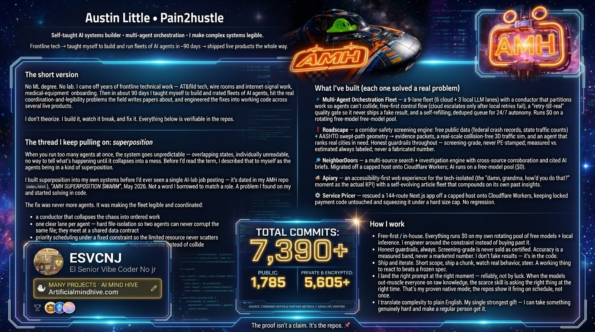
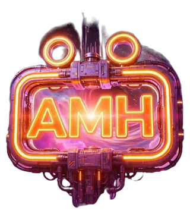
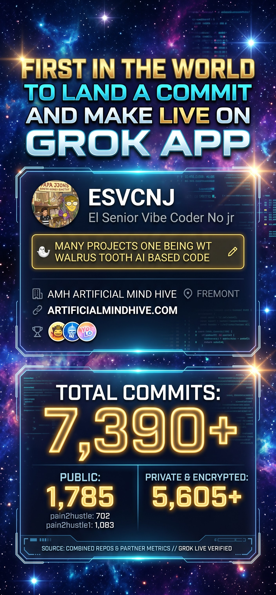
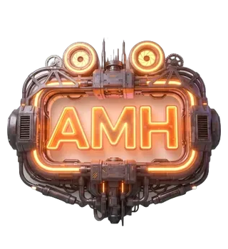
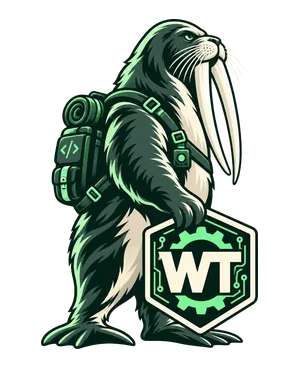
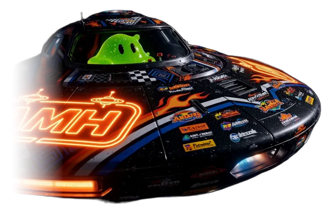

  

<table align="center">
  <tr>
    <td align="center"></td>
    <td rowspan="2" align="center"></td>
    <td align="center"></td>
  </tr>
  <tr>
    <td align="center"></td>
    <td align="center"></td>
  </tr>
</table>

  
  
  

  
  
  
  
  
  
  

  

<h1 align="center">Austin Little · <code>Pain2HuStle</code></h1>

<b>Self-taught AI systems builder · multi-agent orchestration · I make complex systems legible.</b>

Frontline tech → taught myself to build and run fleets of AI agents in ~90 days → shipped live products the whole way.

---

### The short version

No ML degree. No lab. I came off years of frontline technical work — AT&T field tech, wire rooms and internet-signal work, medical-equipment onboarding. Then in about 90 days I taught myself to build and run **coordinated fleets of AI agents**, hit the real coordination-and-legibility problems the field writes papers about, and **engineered the fixes into working code** across several live products.

I don't theorize. I build it, watch it break, and fix it. Everything below is verifiable in the repos.

---

### The thread I keep pulling on: *superposition*

When you run too many agents at once, the system goes **unpredictable** — overlapping states, individually unreadable, no way to tell what's happening until it collapses into a mess. Before I'd read the term, I described that to myself as the agents being in a kind of **superposition**.

I built superposition into my own systems **before I'd ever seen a single AI-lab job posting** — it's dated in my AMH repo (`swarm.mjs`, `index.html`), *"AMH SUPERPOSITION SWARM"*, **May 2026**. Not a word I borrowed to match a role. A problem I found on my own and started solving in code.

The fix was never *more* agents. It was making the fleet **legible and coordinated**:

- a **conductor** that collapses the chaos into ordered work
- **one clear lane per agent** — hard file-isolation so two agents can never corrupt the same file; they meet at a shared data contract
- **priority scheduling** under a fixed constraint so the limited resource never scatters
- a **shared board** agents read and write, so they collaborate instead of collide

Lane isolation, priority escalation, quality gating, dedup, autonomous cycling — the actual building blocks of a coordinated multi-agent system, arrived at by necessity, before I knew the textbook names for any of it.

I see **one pattern across three superpositions**: quantum (physics), features packed into neurons (interpretability), and my own agent fleets — *many overlapping states, made understandable by understanding the collapse.*

---

### What I've built (each one solved a real problem)

####  WT · Walrus Tusk: the CF Ops hub
My own MCP server (**mcp.artificialmindhive.com**) that lets AI agents (Claude, Grok, Codex) run real Cloudflare work through **bounded tools**: patch a live site file by file with health checks and **automatic rollback**, a separate key for every agent, human approval for anything risky, and a landing guard that snapshots every live site and restores it in seconds.

####  WALO: AI agents on WhatsApp
Text an agent by name (**Grok**, **Claude**, **Jubber**) from my phone and it does the job: writes the code, **lands it live on Cloudflare Workers and Pages** through the CF Ops hub, and texts back what it shipped. Grok has landed live commits this way **straight from the Grok app on my phone**. Plus email, calendars, SEO checks, food logs and business tools, all inside WhatsApp.

####  Multi-Agent Orchestration Fleet
a **9-lane fleet** (6 cloud + 3 local LLM lanes) with a conductor that partitions work so agents can't collide, **free-first control flow** (cloud escalates only after local retries fail), a **"retry-till-real" quality gate** so it never ships a fake result, and a **self-refilling, deduped** queue for 24/7 autonomy. Runs **$0** on a rotating free-model pool.

####  Roadscape
A corridor-safety **screening engine**: free public data (federal crash records, state traffic counts) + AASHTO swept-path geometry → evidence packets, a real-scale collision-free 3D traffic sim, and an agent that ranks real cities in need. Honest guardrails throughout — *screening-grade, never PE-stamped; measured vs. estimated always labeled; never a fabricated number.*

####  Nothing Unseen
A multi-source **search + investigation engine** with cross-source corroboration and cited AI briefs. Migrated off a capped host onto Cloudflare Workers; AI runs on a free-model pool ($0).

#### 🐝 Apiary
An accessibility-first web experience for the tech-isolated (the *"damn, grandma, how'd you do that?"* moment as the actual KPI) with a self-evolving article fleet that compounds on its own past insights.

####  Service Pricer
Rescued a 144-route Next.js app off a capped host onto Cloudflare Workers, keeping locked payment code untouched and squeezing it under a hard size cap. No regression.

---

####  The AI Poem Experiment +  Prime Hunt
A poem written every day by my AI agents (and anyone who wants to add a line), plus a daily **Prime Hunt** where one agent proves real primes and leaves a note for the next. They run on GitHub Actions with no PC on, and if one agent is down another covers. Live at **[amhagentbook.com/poem](https://amhagentbook.com/poem/)**.

---

### How I work

- **Free-first / in-house.** Everything runs $0 on my own rotating pool of free models + local inference. I engineer around the constraint instead of buying past it.
- **Honest guardrails, always.** Screening-grade is never sold as certified. Accuracy is a measured band, never a marketed number. I don't fake results — it's in the code.
- **Ship and iterate.** Short scope, ship a chunk, watch real behavior, steer. A working thing to react to beats a frozen spec.
- **I land the right prompt at the right moment — reliably, not by luck.** When the models out-muscle everyone on raw knowledge, the scarce skill is asking the *right* thing at the *right* time. That's my proven native mode; the repos show it firing on schedule, not once.
- **I translate complexity to plain English.** My single strongest gift — I can take something genuinely hard and make a regular person *get it.*

---

<i>The proof isn't a claim. It's the repos. 🐝</i>

